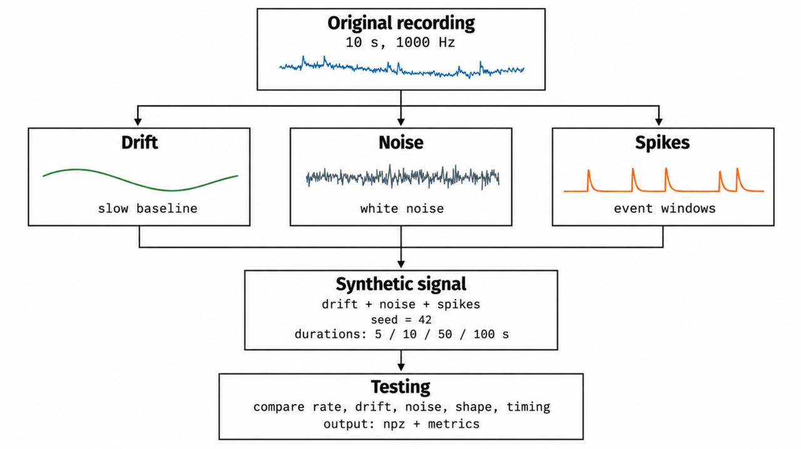

# Project overview

This project analyzes a 10-second neural recording and uses its estimated drift, noise, spike shape, and activity rates to generate simulated recordings of different durations. It then compares the simulations with the original data.

**Authors:** Miloserdov Daniil, Anandita Banerjee, Mateo Maya Martinez



See [Student_Report.md](https://github.com/Anandita06/reverse_engineering_neural_spike_simulation/blob/main/Student_Report.md) for the full analysis and report.

## Project layout

- `src/`: shared analysis functions and standalone validation script
- `scripts/`: preprocessing, simulation, and comparison pipeline
- `data/`: original recording and generated simulation files
- `results/`: comparison table
- `plots/`: generated figures and overview images

Install the required Python packages from the repository root:

```powershell
python -m pip install -r requirements.txt
```

Run commands from the repository root:

```powershell
python -i .\scripts\01_preprocessing_and_analysis.py
```

When the first stage finishes and shows the `>>>` prompt, run the simulation and comparison stage in that same session:

```python
exec(open("scripts/02_simulation_and_comparison.py", encoding="utf-8").read())
```

Run the independent measurement check from the repository root:

```powershell
python -m src.testing_module
```
