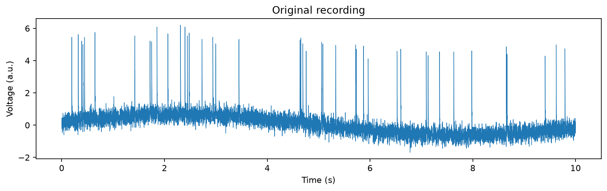
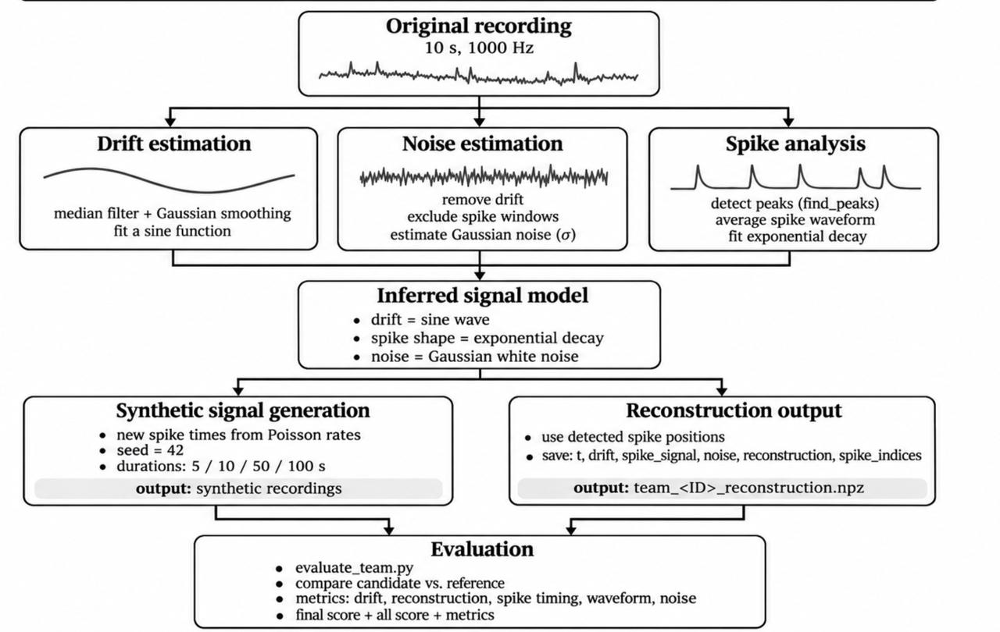
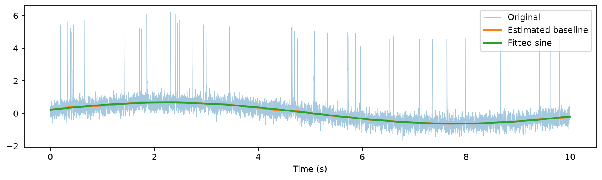
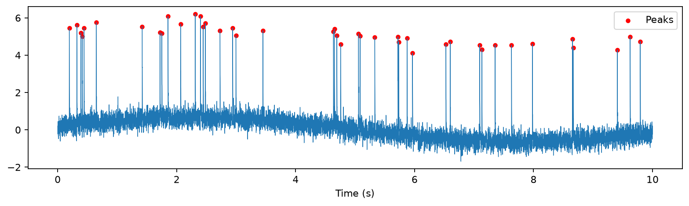
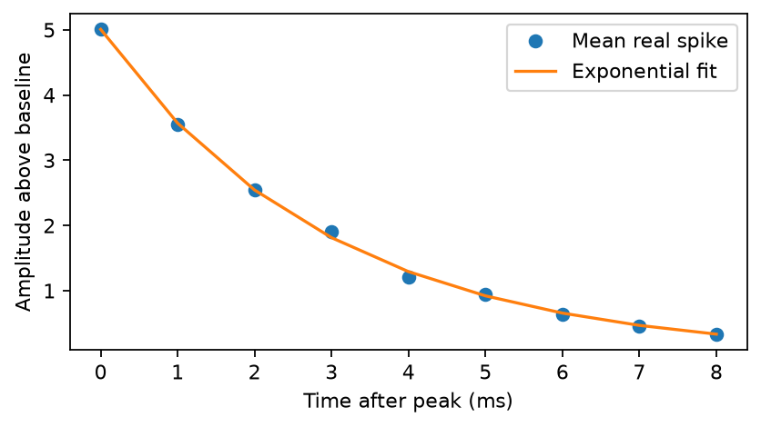
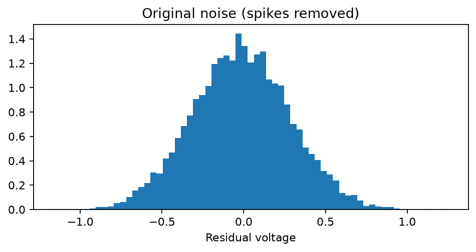
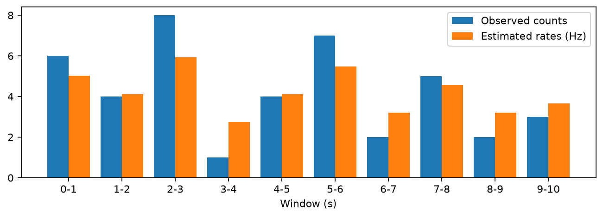
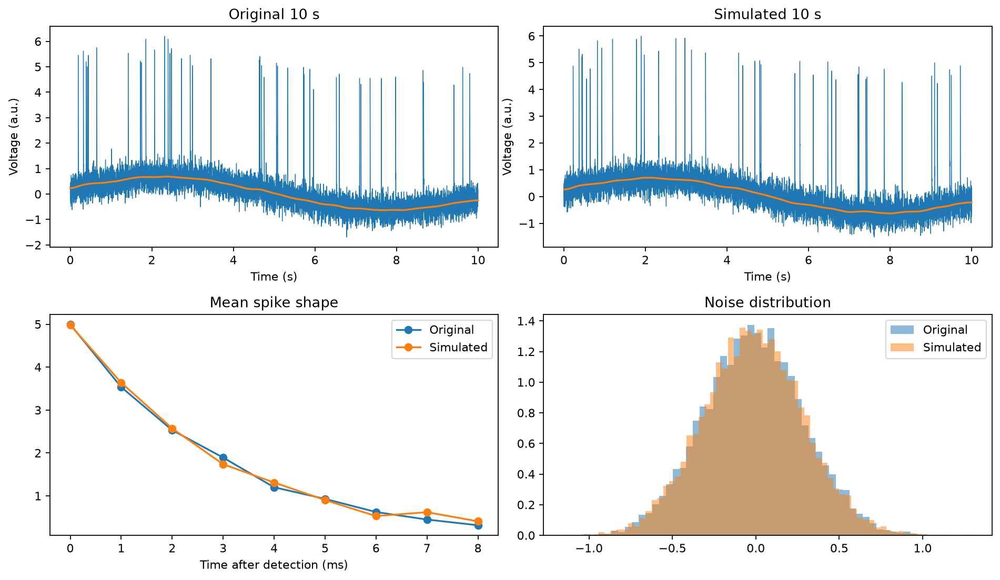

# Reverse Engineering of Noisy Neural Data

## 1. Our idea

We had a 10-second recording (10,000 samples, 1000 Hz) with spikes, noise and a slowly changing baseline. We decided to make a new recording by adding **three parts**:

\[
V(t) = D(t) + N(t) + S(t)
\]

We first estimated these three components and used the fitted model to generate new recordings of 5, 10, 50 and 100 seconds. Later, for the inter-team competition, we also used the same approach to reconstruct the **original 10-second recording** and wrote a separate evaluator to compare teams. These are two different tasks: simulation makes new random recordings, while reconstruction tries to explain the recording we were given.

*Figure 1. Original 10-second recording used to estimate the signal components.*

| Part | What we used | Why we chose it |
|---|---|---|
| **Drift** | Sine function: `c + A sin(2πft + phase)` | The baseline slowly goes up and down; we thought a sine would be an easy approximation. |
| **Noise** | Gaussian white noise | After removing the spikes and drift, the background looked approximately normally distributed and not strongly correlated. |
| **Spike shape** | Exponential decay: `A_spike × exp(-t/tau)` | The visible spikes have a fast peak and a decreasing tail. We discussed this function as a simple first model. |
| **Spike times** | Poisson counts in 1-second activity windows, plus 5-ms refractory time | From our lesson: activity is not the same everywhere. A Poisson model makes new random spikes, while the refractory time prevents events that are too close. |

*Updated pipeline. The fitted signal model is used in two ways: to generate new recordings with random spike times and to reconstruct the observed recording using detected spike positions. The two outputs are checked using different evaluation methods.*

## 2. How we estimated the parameters

For the **drift**, we first applied a 301-ms median filter and Gaussian smoothing (120 ms), to reduce the influence of spikes. Then we fitted the sine function with `scipy.optimize.curve_fit`. We got an amplitude of about **0.647**, a frequency of **0.0898 Hz** (period about **11.14 s**), offset **0.020** and phase **0.319 rad**.

*Figure 2. Original signal, smoothed baseline estimate, and fitted sine drift.*

For **spikes**, we used `scipy.signal.find_peaks` on the signal after subtracting the estimated baseline. We selected clear positive peaks (height 2.4, prominence 2.0, at least 7 ms apart). We found **42 spikes**, or **4.2 Hz** on average. To estimate the shape, we aligned the first 9 samples from each peak, averaged them and fitted an exponential. This gave an amplitude of **5.008** above the baseline and **tau = 2.952 ms**.

*Figure 3. Positive spike peaks detected in the original recording.*

*Figure 4. Mean detected spike waveform and its fitted exponential decay.*

For **noise**, we removed the fitted drift and excluded 12 ms before and 26 ms after each spike. The standard deviation of the remaining values was **0.299**. We use this number when generating Gaussian noise.

*Figure 5. Residual voltage distribution after excluding detected spike regions.*

For **activity windows**, we counted spikes in each second. Since there are only 10 windows, we did not want to use the observed count as the exact true rate. We applied a simple *shrinkage* correction towards the overall mean (4.2 Hz). We calculated the factor from the excess variance of window counts: **0.454**.

| Time (s) | Original spike count | Rate used in the simulation (Hz) |
|---|---:|---:|
| 0–1 | 6 | 5.02 |
| 1–2 | 4 | 4.11 |
| 2–3 | 8 | 5.92 |
| 3–4 | 1 | 2.75 |
| 4–5 | 4 | 4.11 |
| 5–6 | 7 | 5.47 |
| 6–7 | 2 | 3.20 |
| 7–8 | 5 | 4.56 |
| 8–9 | 2 | 3.20 |
| 9–10 | 3 | 3.66 |

*Figure 6. Observed spike counts and shrinkage-adjusted rates used for simulation in each one-second window.*

## 3. Simulation and testing

In every activity window, we draw a new spike count from a Poisson distribution and place these spikes at random moments. We add the exponential spike shape, sine drift and new Gaussian noise. We use **random seed 42**, so the results can be reproduced. For recordings longer than 10 seconds, the rates are shuffled in later blocks, instead of repeating the original signal. We save two arrays, `t` and `raw_data`, as in the original `.npz` file.

We also wrote a **testing part**. It reads both recordings and detects spikes again using an adaptive threshold (local median + `6 × 1.4826 × MAD`, 500-ms window, 5-ms refractory period, with an approximate fast MAD). We compare the firing rate, drift, noise distribution, spike amplitude/decay, variability of one-second counts (**Fano factor**) and inter-spike intervals (**ISI**). We used KS distance for comparing distributions. We think these tests are better than comparing every sample with RMSE, because spike times and noise are random.

### Full comparison of original and simulated data

We compared the original 10-second recording with the 10-, 50- and 100-second simulations. We also added a **closeness (%)** column for the 10-second simulation. For suitable parameters, we calculated it as `100 × max(0, 1 − abs(simulated − original) / abs(original))`. A value near 100% means that the two numerical estimates are close. We do **not** calculate this percentage for duration, counts, values near zero, or metrics where a relative percentage is not very meaningful. The dash (—) means *not calculated*, not a failed test.

*Figure 7. Original and simulated 10-second recordings, measured spike shape, and residual noise distributions.*

| Metric | Original | 10 s | 10 s closeness (%) | 50 s | 100 s |
|---|---:|---:|---:|---:|---:|
| Samples | 10000 | 10000 | — | 50000 | 100000 |
| Duration (s) | 10.000 | 10.000 | — | 50.000 | 100.000 |
| Sampling rate (Hz) | 1000.000 | 1000.000 | — | 1000.000 | 1000.000 |
| Min voltage | -1.691 | -1.513 | — | -1.629 | -1.668 |
| Max voltage | 6.202 | 5.993 | — | 6.322 | 6.322 |
| Mean voltage | 0.077 | 0.087 | — | 0.140 | 0.092 |
| Median voltage | 0.035 | 0.055 | — | 0.117 | 0.048 |
| Voltage SD | 0.734 | 0.726 | **98.821** | 0.724 | 0.718 |
| Baseline mean | 0.020 | 0.034 | — | 0.083 | 0.037 |
| Baseline range | 1.322 | 1.334 | **99.069** | 1.342 | 1.362 |
| Detected spikes | 42 | 40 | — | 218 | 421 |
| Firing rate (Hz) | 4.200 | 4.000 | **95.238** | 4.360 | 4.210 |
| Spike amplitude | 4.998 | 5.009 | **99.786** | 5.014 | 4.985 |
| Spike decay tau (ms) | 2.933 | 2.962 | **99.000** | 2.946 | 2.937 |
| Noise SD | 0.299 | 0.299 | **99.949** | 0.297 | 0.297 |
| Mean ISI (ms) | 234.098 | 243.462 | **96.000** | 228.636 | 236.902 |
| Median ISI (ms) | 169.000 | 162.000 | **95.858** | 150.000 | 159.000 |
| Baseline RMSE (first common 10 s) | 0.000 | 0.027 | — | 0.028 | 0.028 |
| Our similarity score / 100 | 100.000 | **97.436** | — | 98.387 | 98.517 |

*Closeness is calculated from full-precision values, so recalculating it from the rounded table entries can give a slightly different result. This percentage is not a confidence interval or the probability that the model is correct. For longer simulations, the number of spikes grows with recording duration, so firing rate is more useful for comparison than the total count.*

### Our similarity score

We did not use point-by-point MSE as the main score, because the noise and spike times are random. Instead, we made our own **weighted score out of 100** based on nine properties:

| Criterion | Weight | What we compared |
|---|---:|---|
| Firing rate | 20 | Spikes per second |
| Baseline drift | 20 | RMSE of the estimated baselines on the common time interval |
| Noise standard deviation | 12 | How strong the background noise is |
| Noise distribution | 8 | Kolmogorov–Smirnov (KS) distance |
| Noise autocorrelation | 5 | Correlation between neighbouring noise samples |
| Spike amplitude | 10 | Average height of the detected spikes |
| Spike decay | 10 | Exponential decay time constant (tau) |
| Activity variability | 10 | Fano factor of spike counts in one-second windows |
| ISI distribution | 5 | KS distance between inter-spike intervals |
| **Total** | **100** | |

For each criterion, we calculated the difference between the original and simulated value and converted it into points:

`points = weight * exp(-0.5 * (difference / tolerance)**2)`

We chose practical tolerances for different measurements, and then added all the points. The score is **our own heuristic**, not an official grade or a statistical proof. Some metrics used inside the score (for example, Fano factor and KS distance) are not shown separately in the full comparison table to keep it shorter. For the 10-second simulation, the average spike shape and noise distribution looked especially close to the original.

## 4. Reconstruction for the inter-team competition (new)

For the competition, we needed to save our **estimate of the components of the original 10-second recording**, rather than another randomly generated signal. We added `scripts/03_create_reconstruction.py` for this. It independently runs the same estimation steps described above: smoothing and fitting the drift, finding positive spikes, fitting their average exponential shape, and estimating the noise level.

For reconstruction, we **do not use the Poisson process to choose new spike times**. Instead, we put the fitted spike waveform at the 42 peak positions detected in the original recording. We add these spike waveforms to the fitted sine drift to obtain a clean structured estimate:

`reconstruction = drift + spike_signal`

We estimate the noise strength from the remaining signal outside spike windows and save a **separate newly generated Gaussian noise array** using seed 42. This array represents the assumed noise model; it is **not the exact noise originally present** in the recording. It is not added to the submitted `reconstruction` array, following the written instruction in the competition handout.

The script creates `team_3_reconstruction.npz` with the six requested arrays:

| Array | What it contains |
|---|---|
| `t` | Original time vector (10,000 samples) |
| `drift` | Fitted sine drift (10,000 samples) |
| `spike_signal` | Fitted spike waveforms placed at detected positions (10,000 samples) |
| `noise` | Separate Gaussian noise realization, seed 42 (10,000 samples) |
| `reconstruction` | Drift + spike signal, without the newly generated noise (10,000 samples) |
| `spike_indices` | The 42 detected spike **peak** indices |

We use peak indices as the start of our simplified spike template. The actual onset of a biological spike may occur earlier, so these indices are an approximation of the requested spike starting indices.

## 5. Evaluating the reconstructions (new)

We also added `evaluate_team.py`, which implements the required `evaluate(reference_file, candidate_file)` function. It checks the submitted file format first: required arrays, sizes, time vector, valid spike indices, and whether `reconstruction` equals `drift + spike_signal`. Invalid files receive a score of zero.

For valid files, we compare five aspects of the candidate reconstruction with estimates obtained from the original recording:

| Criterion | Points | How we evaluate it |
|---|---:|---|
| Drift | 20 | RMSE against a smoothed baseline estimate |
| Structured reconstruction | 30 | RMSE against the original recording, allowing for the estimated noise level |
| Spike timing | 25 | F1 score for matching detected spikes within ±5 ms |
| Spike shape | 15 | RMSE of the average 9-sample spike waveform |
| Noise | 10 | Noise standard deviation, mean, and lag-1 autocorrelation |
| **Total** | **100** | |

For the error-based metrics, we convert differences into points using a decreasing exponential function. The five scores are added to give the final result. The function returns a dictionary containing validity checks, metrics and `final_score`, so it can be run on our own file or another team's file.

As a basic test, we evaluated `team_3_reconstruction.npz` against `spike_data.npz` and obtained **99.908 / 100**. All 42 detected peaks matched within 5 ms. This is a **self-evaluation result**, not an official competition grade. Our reconstructor and evaluator use similar baseline and spike-detection procedures, which can favour our own submission. Also, the hidden true drift, spikes and noise are unknown. The evaluator therefore measures consistency with estimates from the raw recording, not absolute recovery of the true components.

The earlier **97.436 / 100** score for the 10-second synthetic recording and this **99.908 / 100** score measure different things and should not be compared as if they were the same test. The first checks the *statistics of a new random recording*; the second checks the *alignment and quality of the reconstructed original recording*.

## 6. Limitations and sources of our ideas

For the **synthetic recordings**, we cannot reproduce the original random noise or the same spike moments, and we do not try to. For the **reconstruction**, we use detected spike positions, but the original hidden components are still unknown. We only have 10 seconds, so the periodic drift and the activity of a 100-second recording are **assumptions**. Our spike shape is simplified: we model the decay but not the full action potential. We would like to improve the ISI distribution later, and a more independent reference-spike detection method would make the inter-team evaluator fairer.

The main ideas came from **our class discussion** (Poisson process and activity windows), **Assignments 2A/2B** (spike detection and refractory period) and **basic mathematics** (sine and exponential functions). We used **ChatGPT and GitHub Copilot** for brainstorming, suggestions for Python code, debugging and ideas for the testing part. We checked the fitted numbers and outputs against the original recording. These tools helped us write and improve the code, but we made the modelling choices and discuss their limitations here. For Python functions we used the [SciPy documentation for `find_peaks`](https://docs.scipy.org/doc/scipy/reference/generated/scipy.signal.find_peaks.html) and [`curve_fit`](https://docs.scipy.org/doc/scipy/reference/generated/scipy.optimize.curve_fit.html).
